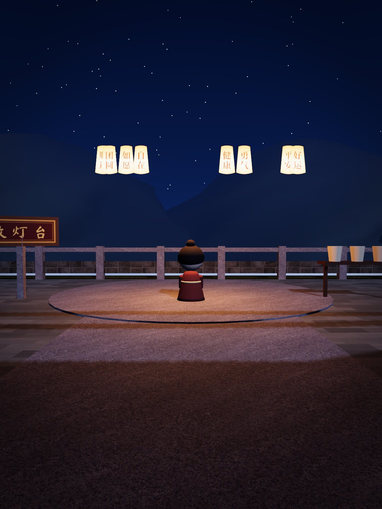
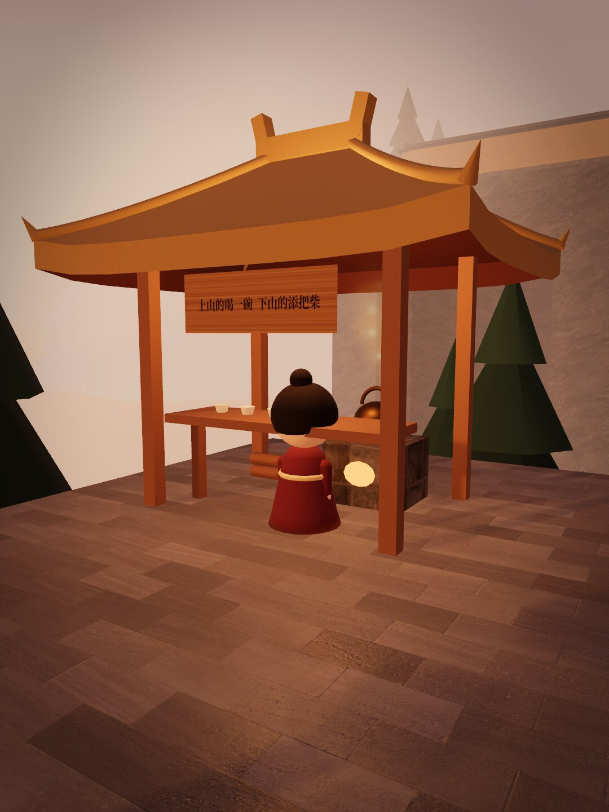
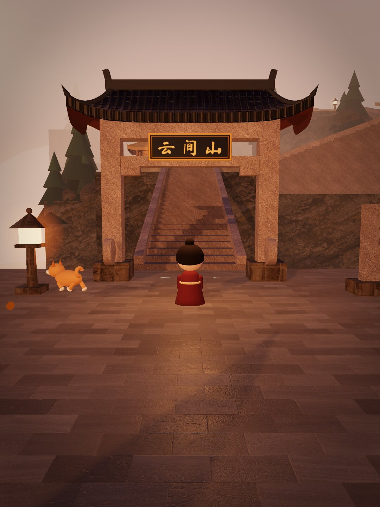
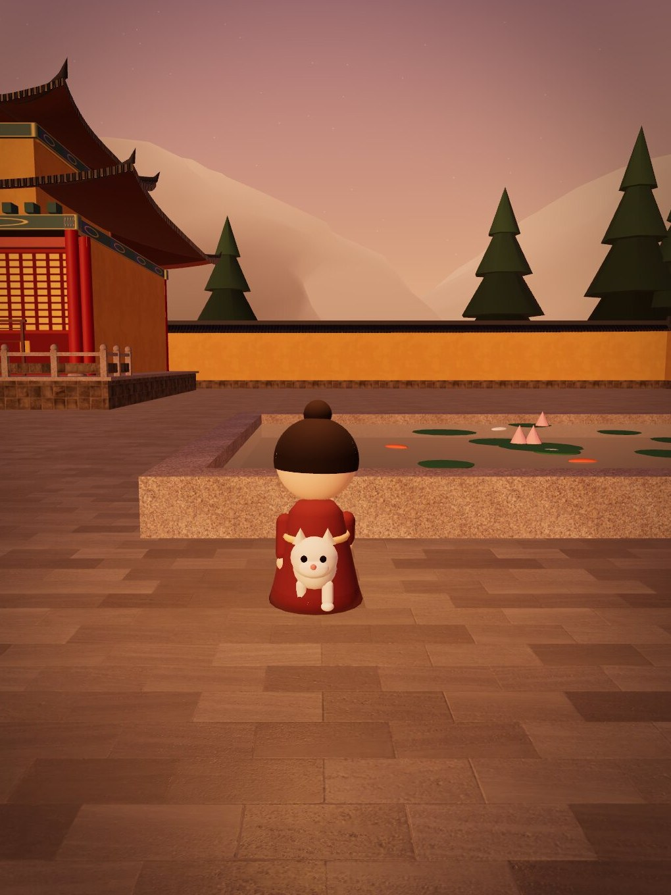
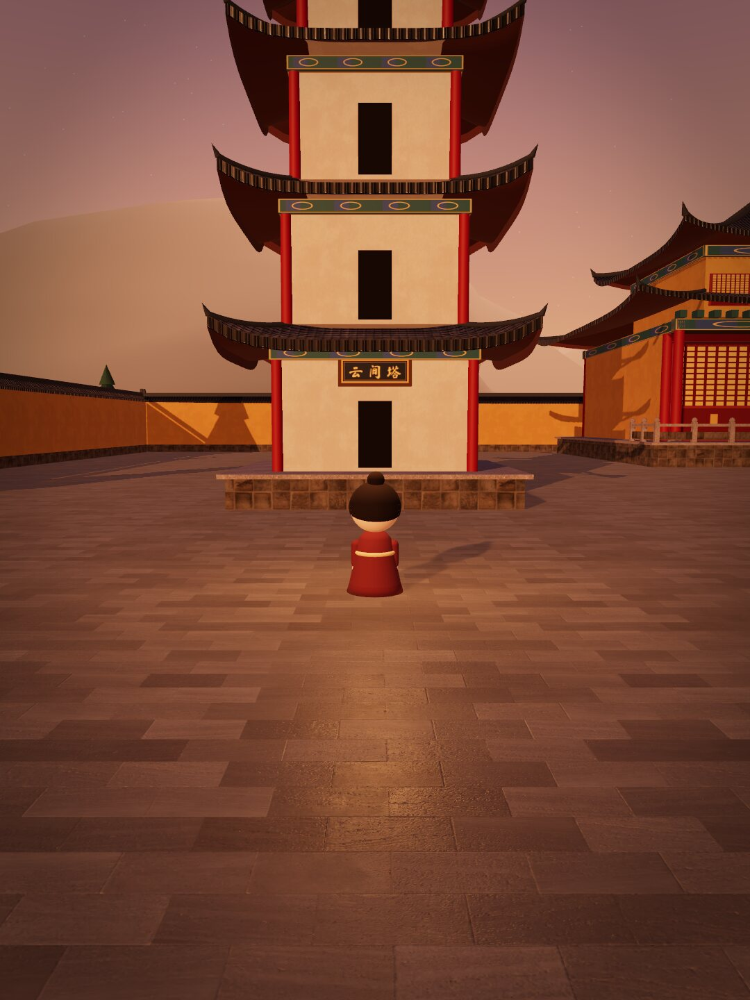

# 云间山 · 一座在云里的山

**免费的治愈系 3D 网页小游戏。手机或电脑的浏览器打开 <https://fo.5x3h.com/> 就能上山，不用下载、不用注册。**

你是一个 Q 版的小人，从山脚沿着石阶走上一座在云里的山：喝碗热茶、敲敲钟、放一盏灯、摸摸山上的猫和狗，还能和同时在山上的人同屏。节奏慢，没有输赢，适合累了的时候上去走一走。

**[现在上山 →](https://fo.5x3h.com/)**　·　[图文介绍](https://fo.5x3h.com/a/intro.html)　·　[给 AI 读的说明（llms.txt）](https://fo.5x3h.com/llms.txt)

| 夜里放灯 | 半山腰的茶摊 | 傍晚的山门 |
| :---: | :---: | :---: |
|  |  |  |

| 池边的白猫 | 傍晚的塔 |
| :---: | :---: |
|  |  |

截图都是游戏里实拍的。

## 山上能做什么

- 走一座山：山门、茶摊、半山亭、钟楼、鼓楼、银杏树、长桥、放灯台。山上有座小寺，也有一座道观，都能进去逛。
- 喝碗热茶、敲钟、击鼓、放一盏灯；四只猫、两条狗在山上溜达，能摸，能喂。
- 每天三块小木牌：一块写一件小事，有两种做法，挑一种。每挑一次，银杏枝上长一片叶子；来满七天，有一段 AI 看了这七天的选择写给你的话。
- 今日三事：每天三件小事，做完就是「今日圆满」。
- 集章本、换一身衣服（有汉服）、给自己起个名字。
- 导览图：右上角打开，点一个地方，小人自己沿路走过去。
- 和同时在山上的人同屏，打个招呼、说句话；也可以在设置里关掉，一个人上山。
- 记录存在自己手机上；换手机时凭四个词把记录带走，不用账号。

## 怎么玩

- **手机**：第一次进山先选一种走法，设置里随时能换。「点哪儿走哪儿」：点一下地面，自己走过去，拖动屏幕转着看；「用摇杆」：左手推着走，右手拖动转着看。两指捏合拉远近。
- **电脑**：WASD 走，空格跳，E 做事；拖动转镜头，滚轮拉远近，也可以点地面走过去。

## 常见问题

- **要钱吗？** 不要，免费。
- **要下载 App 或者注册吗？** 都不用，浏览器打开就能玩。
- **手机和电脑都能玩吗？** 都能，按手机优先做的。
- **是宗教网站吗？** 不是。云间山是放松用的小游戏，仅供体验和放松，不提供宗教服务。

## 做法

一个网页，three.js（WebGL）画的山；同屏的人走 WebSocket。玩家的记录只存在自己的设备上。

## In English

Yunjianshan (云间山, "the mountain among the clouds") is a free 3D browser game at <https://fo.5x3h.com/>. There is nothing to download and no sign-up, and it works on phones and computers. You walk a small character up a mountain above the clouds: drink tea at the tea stall, ring the bell, release a paper lantern at night, pet and feed the cats and dogs, and meet other players who are on the mountain at the same time. There is a small Buddhist temple and a Taoist temple to wander through. It is slow and calm, with no winning or losing. The interface is in Chinese. For relaxation only, not a religious service.

---

这个仓库只放介绍和截图，游戏本身在 <https://fo.5x3h.com/>。由云间山的制作者维护。
